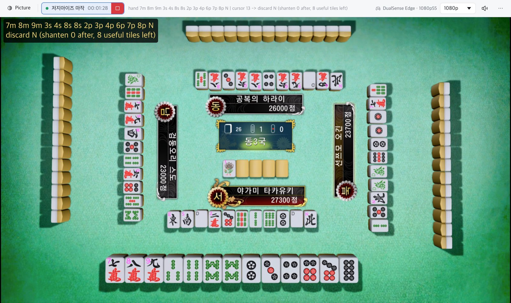
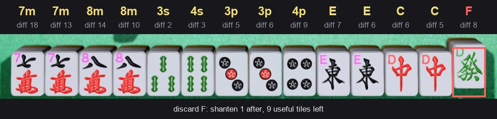
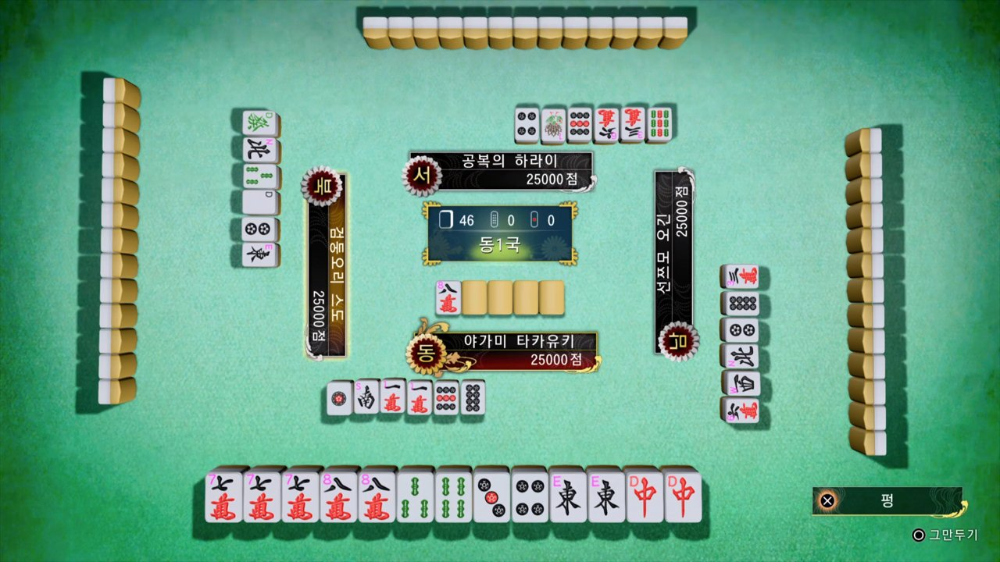
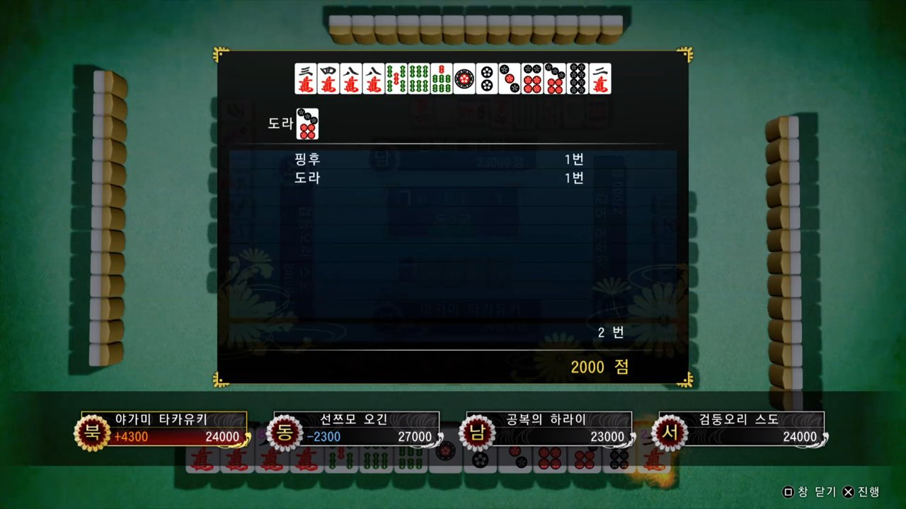
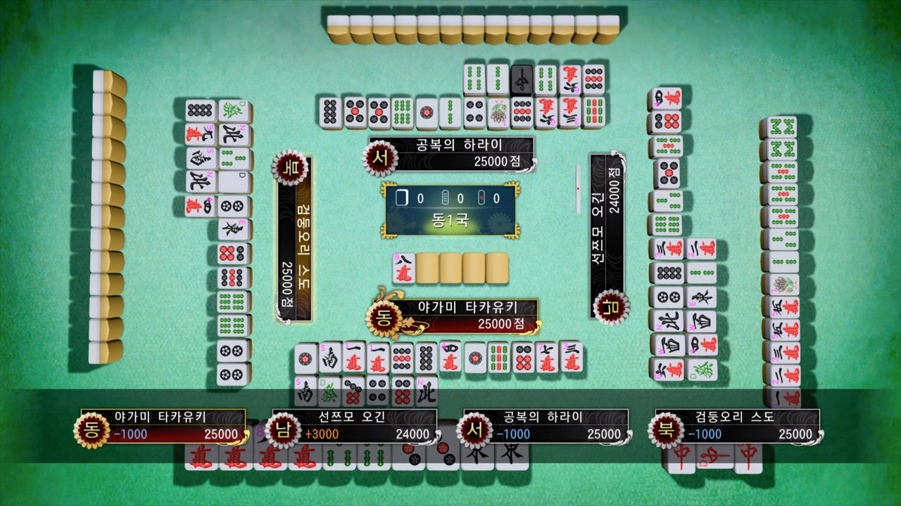

# 저지아이즈 마작 매크로 (PS5 Remote Play + Mac)

PS5에서 돌아가는 저지아이즈(Judgment)의 마작을 Mac에서 Remote Play로 받아, **화면만 보고 대신 치는** 매크로입니다. KamuroGo 완성 목록의 마작 항목(랄러바이·모던·타치바나의 화료 횟수, 탁자 제패)을 채우는 용도입니다. [psconnector](https://github.com/loykin/psconnector) 뷰어의 매크로로 돌아갑니다.

- 손패를 실제 대국 화면에서 잘라 만든 패 그림과 비교해 읽고, 샹텐·유효패를 계산해 버릴 패를 고릅니다.
- 론·쯔모는 받고, 텐파이가 되면 □(액션 커맨드)로 리치를 겁니다. 역패 펑만 받고 치는 넘깁니다(멘젠 유지).
- 결과·정산 화면을 넘기고, 대국이 끝나면 다음 게임을 시작합니다.
- 모르는 패나 처음 보는 선택지가 나오면 화면을 저장하고 멈춥니다. 버튼을 잘못 누르는 대신 멈추는 쪽을 택합니다.



## 한 순 흐름

| 단계 | 하는 일 | 확인 방법 |
|---|---|---|
| 1. 화면 구분 | 결과 화면 → 선택지 → 내 차례 순으로 확인 | 아래쪽 점수 띠, "○ 그만두기" 줄, 손패 장수 |
| 2. 손패 읽기 | 14장(부로가 있으면 11장·8장)을 왼쪽부터 읽음 | 패 그림 비교, 같은 결과가 두 번 연속일 때만 진행 |
| 3. 리치 | 텐파이가 가능하면 □로 액션 커맨드를 열어 "리치" 선택 | 리치 선택지 글자 모양 |
| 4. 버리기 | 샹텐이 가장 낮고 유효패가 가장 많이 남는 패. 리치 중에는 텐파이를 유지하는 패만 | 커서(올라온 패)를 좌우로 옮기며 매번 다시 읽음 |
| 5. 선택지 | ↓로 선택지를 하나씩 확인. 론·쯔모·역패 펑은 ×, 나머지는 ○ | 선택된(어두운) 상자의 글자 모양 |
| 6. 국 종료 | 화료·유국 정산 화면에서 × 진행, 메뉴에서 "게임 시작하기" | 점수 띠, "진행" 글자 |

## 손패 읽기



- 1080p 기준으로 손패는 x = 396 + 73.5 × i, y ≈ 910에 왼쪽부터 놓입니다. 칸마다 `templates/hand/이름_N.png`와 평균 차이를 비교합니다. 정상 패는 차이가 3~18이고, 다른 패와는 20 이상 벌어집니다.
- 커서가 있는 패는 8px 이상 올라와 있습니다. 비스듬히 보여 못 읽으면 커서를 한 칸 옮겨 내린 뒤 다시 읽습니다.
- 버린 패가 강에서 손패 바로 위까지 내려와도 헷갈리지 않게, 손패 윗변은 y = 882 아래에서만 찾습니다.

## 선택지 (치·펑·깡·론·쯔모·리치)



- 모든 선택지 아래에는 "○ 그만두기"가 같은 자리에 있어서, 선택지가 몇 개 쌓여 있든 이것으로 알아봅니다.
- 글자는 OCR 대신 **글자 모양**으로 읽습니다. OCR이 한 글자를 잘못 읽는 일이 있어서입니다(론 → "굴"). 처음 보는 글자는 OCR로 읽고, 그 모양을 `templates/prompt/`에 저장합니다.
- 펑은 어떤 패에 대한 것인지 선택지에 나오지 않습니다. 그래서 직전 화면과 비교해 **방금 버려진 패**를 찾고, 그 색 구성(검정: 풍패, 빨강: 중, 초록: 발·삭수, 빨강+검정: 만수·통수, 무늬 없음: 백)으로 손의 대자 중 어느 것인지 고릅니다. 역패(삼원패, 장풍, 자풍)면 받습니다.
- 자풍은 이름 옆 배지(동·남·서·북)를 `templates/seat/`와 비교해 읽고, 장풍은 가운데 "동1국" 글자를 OCR로 읽습니다.

| 화료 | 유국 |
|---|---|
|  |  |

## 엔진 (`mj/engine.py`)

- 샹텐: 일반형(4멘쯔 1작두, 부로 수 반영), 치또이, 국사 중 가장 작은 값
- 유효패: 샹텐을 하나 줄이는 패와 남은 장수
- 버릴 패: 버린 뒤 샹텐 → 유효패 수 → 고립된 정도(자패·노두패 먼저) 순으로 비교
- 무작위 손패 400개로 "14장 샹텐 = 가장 좋은 버림 뒤 샹텐", "유효패는 샹텐을 정확히 1 줄임"을 검사합니다.

## 랄러바이 목표

| 조건 | 내용 |
|---|---|
| 화료 10회 | 판이 아니라 국 단위로, 론 또는 쯔모 10번 |
| 랄러바이 제패 | 초급 탁자와 중급 탁자에서 각각 대국 종합 1위 (숨겨진 고급 탁자는 필요 없음) |

초급에서 화료 횟수를 채우면서 1위를 노리고, 중급이 어려우면 구련보등 패를 씁니다. 삼색동순·일발 같은 역 항목은 다른 마작장에서 채워도 됩니다.

## 준비

- psconnector-view가 PS5에 연결되어 있고, 화질이 **1080p**여야 합니다.
- [uv](https://docs.astral.sh/uv/)

```bash
uv venv .venv && uv pip install --python .venv/bin/python -r requirements.txt
ln -s ~/Project/judgment-mahjong-macro ~/Project/psconnector/macros/judgment-mahjong
```

psconnector-view 바에서 **Reload macro list** 후 "저지아이즈 마작"을 고르고 ▶. 바의 ■로 멈추고, 옵션에서 시간 제한과 끝난 뒤 휴식 모드를 정할 수 있습니다.

직접 실행할 때:

```bash
.venv/bin/python -u main.py --dry-run     # 판단만 출력하고 아무것도 누르지 않음
.venv/bin/python -u main.py --games 3     # 3게임 뒤 메뉴에서 멈춤
```

## 모르는 화면이 나오면

`unknown/`에 화면이 저장되고 매크로가 멈춥니다(로그에 이유가 나옵니다). 패라면 그 칸을 잘라 `templates/hand/이름_N.png`로, 선택지라면 `templates/prompt/`에 추가하고 다시 실행합니다.

## 테스트

```bash
.venv/bin/python -m unittest discover tests
```

`samples/`의 실제 화면(손패, 선택지 1개·2개, 펑 직전, 화료·유국 정산, 강이 손패 위까지 내려온 화면)으로 인식을 검사합니다.

## 아직 안 되는 것

- 상대 리치에 대한 수비(현물·스지). 대국 1위를 노리려면 필요합니다.
- 타치바나의 오픈 리치, 와레메 규칙
- 서풍 자리 배지는 아직 못 봐서, 다른 셋과 다른 배지를 서로 봅니다.
